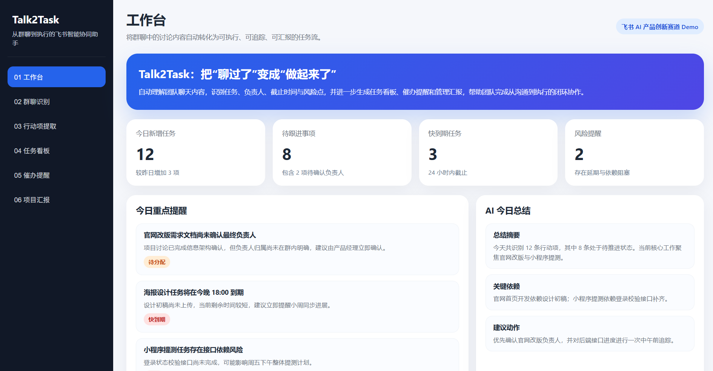
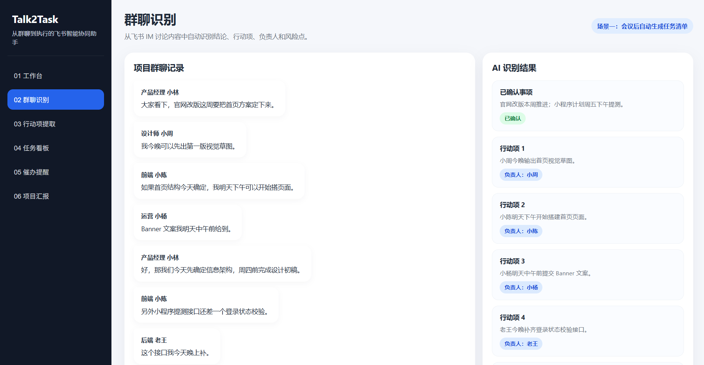
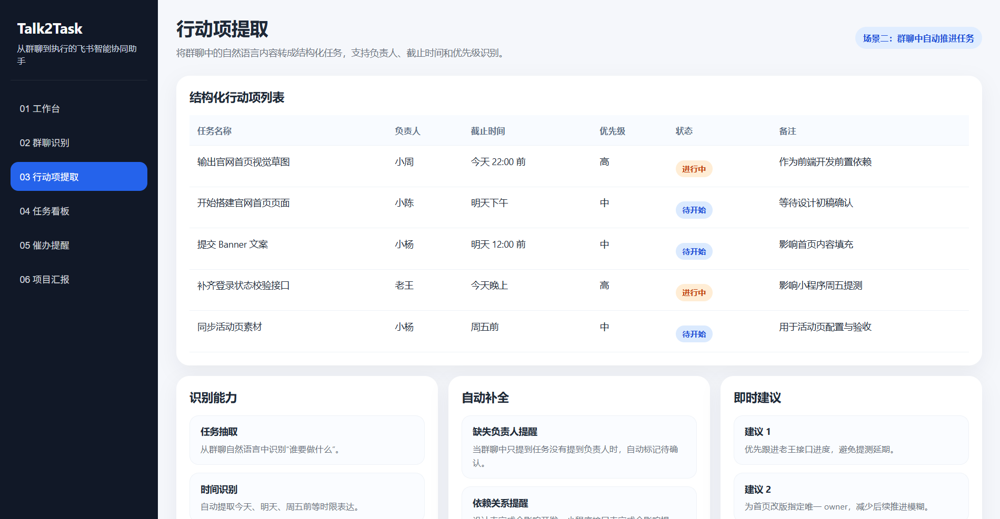
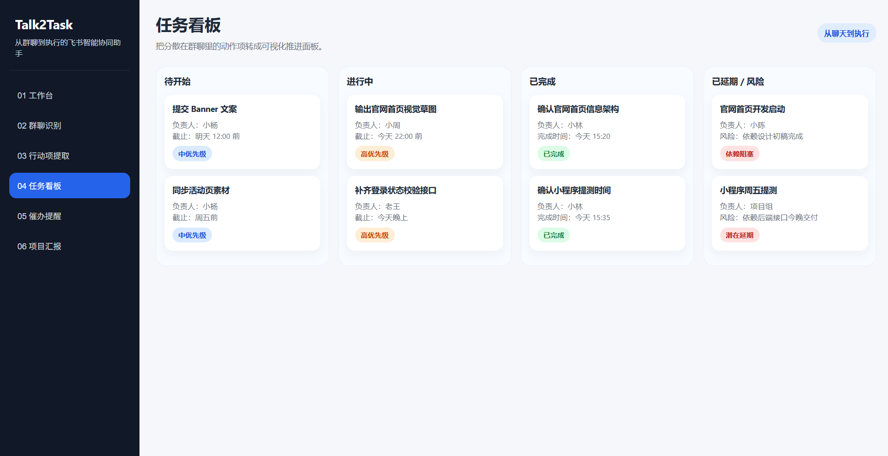
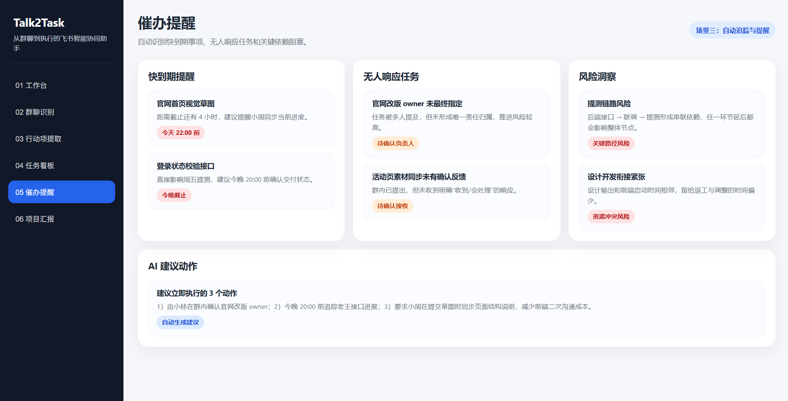
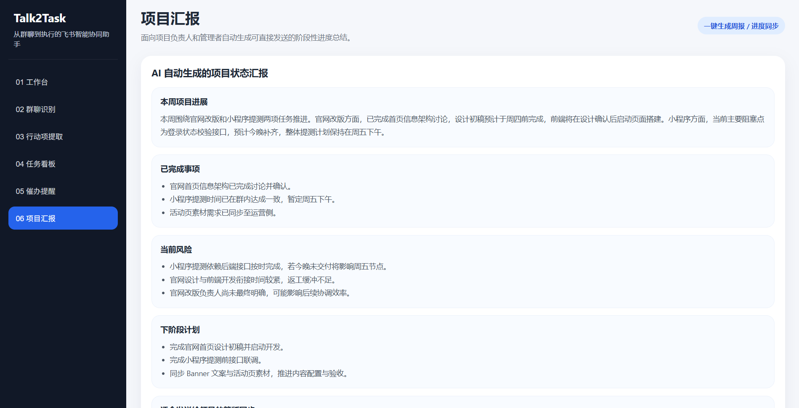

# Talk2Task

从群聊到执行的飞书智能协同助手

---

## 项目简介

Talk2Task 是一个基于飞书 IM 的智能协同助手，能够从群聊和会议讨论中自动提取任务、识别负责人、追踪截止时间，并生成项目汇报，帮助团队实现从沟通到执行的闭环协作。

---

## 项目背景

在飞书等即时通讯工具中，团队每天都会产生大量沟通内容。虽然沟通频繁，但任务信息往往分散在聊天记录中，导致行动项难以追踪、负责人不明确、截止时间不清晰，项目推进依赖人工整理和催办，协同效率较低。

---

## 核心功能

### 1. 群聊智能总结
自动提炼重点讨论内容、已确认结论和待确认问题。

### 2. 行动项自动提取
识别任务名称、负责人、截止时间、优先级。

### 3. 任务看板生成
将聊天中分散的信息转化为结构化任务看板。

### 4. 智能催办与风险提醒
自动检测快到期事项、无人响应任务和阻塞风险。

### 5. 一键生成项目汇报
为团队负责人和管理者自动生成日报、周报和阶段汇报。

---

## Demo 展示

### 1. 工作台

### 2. 群聊识别

### 3. 行动项提取

### 4. 任务看板

### 5. 催办提醒

### 6. 项目汇报

## Demo 展示场景

### 场景 1：会议后自动生成任务清单
团队开会后，AI 自动输出会议摘要、决策结论和行动项列表。

### 场景 2：群聊中自动推进任务
项目群讨论过程中，AI 自动识别新增任务、负责人和截止时间，并提醒关键风险。

### 场景 3：自动生成管理汇报
在管理者追问项目进度时，AI 自动输出进度摘要、已完成事项、风险点和下一步计划。
## 产品亮点

- 从聊天记录直接生成执行闭环
- 原生面向飞书 IM 协作场景
- 同时服务执行层和管理层
- 将总结能力升级为推进能力

---

## 文件说明

- `index.html`：Demo 页面
- `docs/project-book.md`：项目书初稿
- `docs/video-script.md`：视频文案与 AI 提示词
- `README.md`：项目说明文件
- `assets/screenshots`：页面截图
- `assets/video`：录屏和成片

---

## 使用方式

1. 打开 `index.html`
2. 在浏览器中查看 Demo 页面
3. 点击左侧菜单切换不同功能页面

---

## 项目总结

Talk2Task 的核心价值，不只是帮助团队“总结聊天”，而是帮助团队真正“推动执行”。